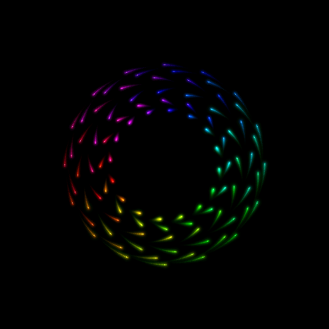
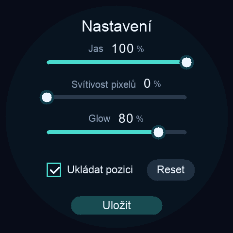

# ARose WaveShare

**Obrazce z éry Amigy, moderní glow a plynulý pohyb na kulatém ESP32 displeji.**

[English](README.md) | **Česky**

Proměnlivé duhové obrazce, měkká záře a světelné stopy — vše běží přímo na ESP32-S3. ARose WaveShare přenáší [ARose ScreenSaver](https://github.com/CooLajz/ARose-ScreenSaver) na kulaté displeje **Waveshare 2.1** a **2.8C**, v nativním rozlišení **480 × 480** a s přibližně **47 FPS**.

  
  

*Skutečné snímky framebufferu zařízení, nikoli fotografie displeje.*

## Vyzkoušejte demo

Z [posledního vydání](https://github.com/CooLajz/ARose-WaveShare/releases/latest) stáhněte factory `.bin` a postupujte podle [návodu k nahrání přes webový flasher](docs/FLASHING.cs.md). Není potřeba nic kompilovat. Jeden firmware automaticky rozpozná oba podporované modely.

- **Waveshare ESP32-S3-Touch-LCD-2.1** — aktuální firmware ověřen na zařízení.
- **Waveshare ESP32-S3-Touch-LCD-2.8C** — renderer ověřen na zařízení; poslední XIP sestavení s nastavením na tomto modelu ještě čeká na ověření.

Jde o varianty ESP32-S3 s rozlišením 480 × 480, 16 MB flash a 8 MB PSRAM. Jiné podobně pojmenované displeje Waveshare podporované nejsou.

## Z přibližně 32 na 47 FPS

Výzvou bylo zachovat moderní záři a plynulé stopy na malém mikrokontroléru. Snižování rozlišení přineslo rozmazané překryvy bodů, proto výsledný renderer kreslí celý obraz **v nativním rozlišení, bez upscalingu**.

Nejvíce pomohla změna způsobu, jak obraz vzniká:

- **Využití již vykresleného světla.** Předchozí obraz postupně slábne a přidávají se nové body. Celá historie stop se nemusí kreslit znovu každý snímek.
- **Práce obou jader.** Výpočet se rozdělí a prázdné oblasti obrazu se přeskakují.
- **Promyšlené rozložení paměti.** Často používané výpočty a malé pracovní buffery mají rychlou interní paměť; celé obrazy jsou v PSRAM.
- **Pohyb nezávislý na FPS.** Simulace běží v 50 Hz a mezilehlé pozice se interpolují, takže rychlost pohybu nezávisí na obnovování displeje.
- **Ukládání bez přerušení obrazu.** Vlastní sestavení SDK a zápis na pozadí umožňují ukládat pozici během animace bez obnovování synchronizace LCD.

Na **2.1** drželo všech 23 celých měřených oken **47,55 FPS**, i při svítivosti a glow na 100 %. Ani skutečné mazání flash stránky při dvouminutovém zápisu v tomto testu nezpůsobilo dlouhou mezeru mezi snímky. Předchozí nativní renderer dosahoval na **2.8C přibližně 46,7 FPS**.

Jde o výsledky konkrétních měřených sekvencí, nikoli záruku pro každý budoucí obrazec. Podmínky testů a záznamy jsou v [technické dokumentaci](docs/TECHNICAL.cs.md).

## Dotykové ovládání

**Krátce klepněte** pro pauzu nebo pokračování. Zpomalení i rozjezd trvají plynulé **dvě sekundy**. **Podržte prst přibližně 0,7 sekundy** pro otevření nastavení.

| Nastavení | Význam | Výchozí hodnota čisté instalace |
| --- | --- | --- |
| Jas | Podsvícení displeje | 100 % |
| Svítivost pixelů | Síla světla samotných bodů | 50 % |
| Glow | Síla okolní záře | 80 % |
| Ukládat pozici | Pokračování od posledního checkpointu | Zapnuto, každé 2 minuty |
| Reset | Restart obrazce po uložení | — |
| Uložit | Zápis nastavení a návrat k animaci | — |

Svítivost je nejvíce patrná u tmavších barev; její stupnice 0–100 není obrazově totožná s desktopovou verzí. Glow mění sílu záře, její velikost zůstává stejná.

Aktualizace zachová již uložené nastavení. Ukládá se matematický stav obrazce, světelné stopy se po restartu postupně vytvoří znovu. Demo běží samostatně, bez Wi-Fi nebo připojeného počítače.

## Sestavení, testy a poděkování

Návody k SDK, sestavení, testům a podrobnosti ukládání jsou v [technické dokumentaci](docs/TECHNICAL.cs.md). Hotový firmware naleznete v [Releases](https://github.com/CooLajz/ARose-WaveShare/releases).

Původní **ARose** vytvořili **Wolfgang Breyha a Michael Matzl, 1994–1995**. Projekt navazuje na [ARose ScreenSaver](https://github.com/CooLajz/ARose-ScreenSaver) a používá ovladače upravené z [WaveShare Hodiny](https://github.com/CooLajz/waveshare-hodiny) a příkladů Waveshare.

Rozsah licence a původ součástí uvádějí [LICENSE](LICENSE) a [THIRD_PARTY_NOTICES.md](THIRD_PARTY_NOTICES.md). Jde o nezávislé komunitní demo, nikoli oficiální firmware Waveshare.
