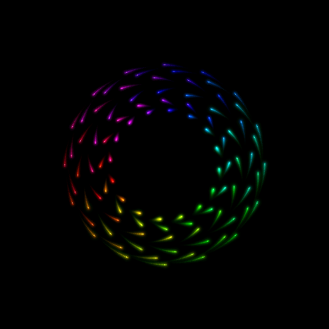
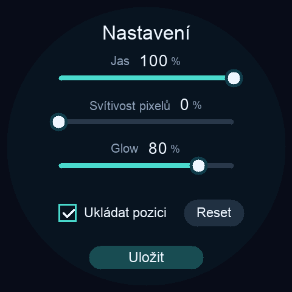

# ARose WaveShare

**Amiga-era generative art, modern glow, and smooth motion on a round ESP32 display.**

**English** | [Česky](README.cs.md)

Evolving rainbow patterns, soft light, and glowing trails — running entirely on an ESP32-S3. ARose WaveShare brings [ARose ScreenSaver](https://github.com/CooLajz/ARose-ScreenSaver) to the round **Waveshare 2.1** and **2.8C** displays, with native **480 × 480** rendering and approximately **47 FPS**.

  
  

*Actual device framebuffer captures, not photographs of the panel.*

## Try it

Download the factory `.bin` from the [latest release](https://github.com/CooLajz/ARose-WaveShare/releases/latest) and install it using the [web flashing guide](docs/FLASHING.md). No compilation is needed. One firmware detects both supported boards automatically.

- **Waveshare ESP32-S3-Touch-LCD-2.1** — current firmware tested on hardware.
- **Waveshare ESP32-S3-Touch-LCD-2.8C** — renderer tested on hardware; the latest XIP/settings build still needs validation on this model.

Both are the 480 × 480 ESP32-S3 versions with 16 MB flash and 8 MB PSRAM. Other similarly named Waveshare boards are not supported.

## From about 32 FPS to 47 FPS

The challenge was keeping modern glow and smooth trails on a small microcontroller. Reducing the image resolution made overlapping points look blurry, so the final renderer draws the whole picture at **native resolution, without upscaling**.

The biggest gains came from changing how the image is built:

- **Reuse the light already on screen.** Gently fade the previous picture and add new points, instead of redrawing the entire trail history every frame.
- **Use both CPU cores.** Share the rendering work and skip empty parts of the image.
- **Put memory where it helps most.** Keep frequently used calculations and small working buffers in fast internal memory; store full images in PSRAM.
- **Keep motion independent of rendering.** A 50 Hz simulation and interpolated positions make movement consistent across display refresh rates.
- **Save without interrupting the display.** A custom SDK setup and background storage allow checkpoints while the animation keeps moving, without resetting the LCD to recover the picture.

On the **2.1**, all 23 complete measurement windows held **47.55 FPS**, even with luminosity and glow at 100%. A real flash-page erase during the two-minute checkpoint caused no long frame gap in that test. The earlier native renderer reached about **46.7 FPS on the 2.8C**.

Those are measured results for tested sequences, not a promise for every future pattern. The [measurement logs and technical details](docs/TECHNICAL.md) explain the test conditions.

## Touch controls

**Tap** to pause or resume, with a smooth **two-second slowdown or acceleration**. **Hold for about 0.7 seconds** to open the compact settings page.

| On-screen label | Control | Clean-install default |
| --- | --- | --- |
| Jas | Display brightness | 100% |
| Svítivost pixelů | Point luminosity | 50% |
| Glow | Halo intensity | 80% |
| Ukládat pozici | Resume from the last checkpoint | On, every 2 minutes |
| Reset | Restart the pattern after saving | — |
| Uložit | Save settings and return | — |

The interface is currently in Czech. Point luminosity is most noticeable in darker colors; its 0–100 scale does not exactly match the desktop renderer. Glow changes the strength of the surrounding light, not its size.

Existing saved settings survive updates. Position saving remembers the mathematical pattern; the light trails build up again after restart. The demo runs independently, without Wi-Fi or a computer.

## Build, tests and credits

For SDK setup, source builds, tests and storage details, see the [technical reference](docs/TECHNICAL.md). Ready-to-flash files are provided in [Releases](https://github.com/CooLajz/ARose-WaveShare/releases).

Original **ARose**: **Wolfgang Breyha and Michael Matzl, 1994–1995**. This project builds on [ARose ScreenSaver](https://github.com/CooLajz/ARose-ScreenSaver), with drivers adapted from [WaveShare Hodiny](https://github.com/CooLajz/waveshare-hodiny) and Waveshare examples.

See [LICENSE](LICENSE) and [third-party notices](THIRD_PARTY_NOTICES.md). This is an independent community demo, not an official Waveshare firmware.
