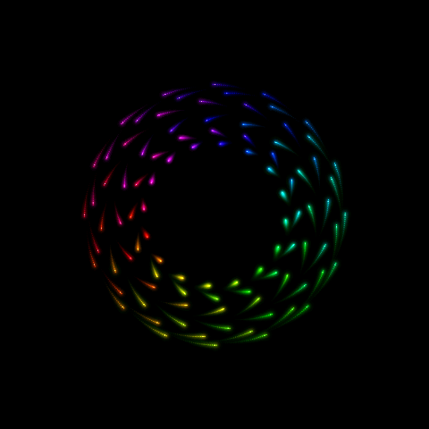

# Ověření prototypu ARose WaveShare

Datum: 30. 10. 2026. Nejde o vydání produkčního firmwaru.

## Zařízení a sestavení

- Fyzické zařízení: ESP32-S3-Touch-LCD-2.8C, rozpoznané pomocí GT911.
- ESP32-S3 rev. 0.2, CPU 240 MHz, 16 MB flash, 8 MB OPI PSRAM.
- Arduino-ESP32 3.0.7, Arduino CLI 1.3.1, optimalizace `-O3`.
- Aktuální požadovaný pixelový takt 13 MHz, tři RGB565 buffery v PSRAM,
  dva přenosové buffery po 40 řádcích v SRAM, ISR na jádře 0.
- Jas 100 %, bez Wi-Fi, OTA a uživatelského nastavení.
- Varianta 2.1 je obsažena v hardwarové detekci a ovladači, ale nebyla
  fyzicky otestována. Výsledky 2.8C nelze vydávat za její měření.

## Automatické kontroly

`tools/test.sh` prošel s AddressSanitizer a UndefinedBehaviorSanitizer:

- 54 referenčních bodů původního desktopového enginu v devíti okamžicích
  do simulačního kroku 30 000; odchylka souřadnic pod 0,02 jednotky.
- Ochranné pixely kolem výstupů zůstaly nezměněné.
- Tři střídající se výstupní buffery odpovídaly samostatnému rendereru
  s jedním výstupem ve 100 časových snímcích.
- Opakované předložení stejného snímku nezměnilo obsah ani nepřidalo světlo.
- Kontrolní obraz před a po sloučení přenosů paměti je bajtově shodný
  (`cmp` nad hostitelskými PPM snímky).
- Odstranění samostatného plátna bylo porovnáno také s původním rendererem
  používajícím samostatné plátno: všech 480 hashů kompletních snímků se
  shodovalo. Test začínal v krocích 0, 7 000, 8 300 a 20 000, střídal tři
  buffery, interpolaci a počet nových simulačních kroků 0–5. Obě verze
  běžely s AddressSanitizer a UndefinedBehaviorSanitizer.

Nejde o test úplné vizuální shody s desktopovým glow. Světelné stopy jsou
skládány novým způsobem v RGB565 a mají jiné doznívání a barevnou přesnost.

## Výsledky dřívějších variant

| Varianta | Pozorování |
| --- | --- |
| Opakované kreslení celé historie | Původně přibližně 7 FPS; příliš pomalé. |
| Glow v nižším rozlišení | Vyšší rychlost, ale uživatelem odmítnuté artefakty při překryvu bodů. |
| Přímý EDMA přenos, 18 MHz | Uživatel potvrdil cestování obrazu. Není aktuálně nasazeno. |
| Perzistentní plátno v RGB565, drobné přenosy po blocích | Většinou 32,3 FPS, ale dokončený tříminutový test odhalil propad na 16,17 FPS kolem kroku 8 766. |
| Totéž se souvislými přenosy | Čtyři minuty / 48 oken: minimum 24,95 FPS, nejdelší render 43,85 ms. Lepší výsledek, ale cíl 30 FPS stále nesplněn; viz [záznam](profile-temporal-spans.txt). |

Poslední uvedené měření má 36 přibližně pětisekundových oken;
viz [celý záznam](profile-temporal-rgb565-long.txt). Rozsah průměrů byl
16,17–32,36 FPS, nejdelší zaznamenaný render 47,81 ms. Počítadla timeoutů
a zahozených simulačních kroků zůstala nulová. Stabilních 30 FPS tento test
**neprokázal**, navzdory dobrému výsledku jeho první části.

## Funkční výchozí varianta: 32 FPS

Tato výchozí varianta používala takt 9 MHz, jednojádrové kreslení
a pracovní pásy vysoké 16 řádků.

Nativní renderer využívá předchozí výstupní framebuffer jako zdroj světla
pro další snímek. Hodnoty pod jasnými hlavičkami jsou uloženy zvlášť v SRAM
a před dalším skládáním obnoveny. Odpadá zápis samostatného plátna do PSRAM
i jeho alokace 460 800 bajtů. Souvislé přenosy a tabulkové zeslabování světla
zůstávají zachovány. Výsledný obraz se touto optimalizací nemění.

Dokončené pětiminutové měření: 60 přibližně pětisekundových oken,
9 720 prezentovaných snímků, simulace do kroku 15 032. Úvodní částečné okno
vyvolané příkazem `?` není zahrnuto. Úplný záznam:
[profile-framebuffer-feedback.txt](profile-framebuffer-feedback.txt).

| Metrika | Naměřená hodnota |
| --- | --- |
| FPS jednotlivých oken | **32,25–32,33** |
| Průměrný čas rendereru v oknech | 7,83–22,65 ms |
| Nejdelší zaznamenaný render | **27,36 ms** |
| Timeouty synchronizace | 0 |
| Zahozené simulační kroky | 0 |
| Volná interní paměť | 36 896–37 096 bajtů |
| Volná PSRAM | 7 002 592 bajtů, bez změny |

Fáze kolem kroků 7 200 a 8 700, které u předchozích variant zpomalovaly,
v tomto běhu držely přibližně 32,3 FPS. **Cíl alespoň 30 FPS byl splněn ve
všech měřených oknech tohoto běhu.** Není to záruka všech budoucích obrazců
ani fyzické ověření modelu 2.1.

Sestavení uspělo: 433 857 bajtů programu, 251 192 bajtů statických globálních
dat (76 % hodnoty uváděné Arduino CLI). Kompilátor upozorňuje na omezenou
zbývající interní paměť; výše uvedené hodnoty jsou měřené za běhu po alokaci
bufferů. Tento prototyp nemá další aplikační služby.

SHA-256 nahraného aplikačního obrazu `build/ARoseWaveShare.ino.bin`:
`1fb33521577b6077f34eaaf6e6305558485d1e8d5b1416a1563ab0ef72d90ee4`.

Tento hash patří výchozí pracovní verzi před následujícími optimalizacemi;
soubor v adresáři `build/` se při dalších sestaveních aktualizuje.

## Vyšší FPS: paralelní kreslení

Renderer nyní rozděluje nezávislé vodorovné pásy mezi obě jádra. Jádro 0
zpracovává třetinu pásů a zároveň přenosy LCD; jádro 1 zbývající dvě třetiny.
Výstup se předává displeji až po dokončení obou pracovníků. Překrývající se
hlavičky používají pevné indexy v seznamu oprav, takže se vlákna nepřepisují.

Další zkoušky zmenšily výšku pracovního pásu z 16 na 4 řádky. Tím se omezil
přenos černých okrajů kolem křivek. Dva pracovní pásy nyní zabírají dohromady
7 680 bajtů interní SRAM. Alokují se až po přenosových bufferech LCD.

První pokus se dvěma velkými pásy a úplnou tabulkou zeslabování se kvůli
alokaci SRAM nerozběhl. Rozdělená tabulka následně uvolnila přibližně 124 KiB
a umožnila měření. Po zmenšení pásů bylo možné vrátit rychlejší úplnou
tabulku 65 536 barev; výsledek zeslabování zůstal stejný.

Doznívání se přepočítává podle periody panelu, aby vyšší FPS zbytečně
nezkracovalo světelnou stopu. Kvantizace RGB565 stále ovlivňuje nejslabší
hodnoty. Simulace zůstává na 50 Hz a hlavičky jsou interpolované.

| Pokus | Výsledek |
| --- | --- |
| 12 MHz, pásy 16 řádků, menší tabulky | Většinou 43,11 FPS, v nejtěžší fázi 34,33 FPS. Uživatel potvrdil lepší plynulost a žádný posun obrazu. [Záznam](profile-parallel-12mhz.txt). |
| 14 MHz, pásy 4 řádky | Většinou 50,30 FPS, v nejtěžší fázi 32,13 FPS. Po úvodním plném okně 130 dlouhých mezer mezi prezentacemi. Proto není vhodné použít tuto frekvenci jako stabilní nastavení. [Záznam](profile-parallel-thin-14mhz.txt). |
| 13 MHz, pásy 4 řádky | Po úvodním plném okně 46,70–46,71 FPS, maximum rendereru 20,15 ms, žádná dlouhá mezera v náročné sekvenci. [Záznam](profile-parallel-thin-13mhz.txt). |
| 13,5 MHz, pásy 4 řádky | Po úvodním plném okně 38,32–48,50 FPS; 51 dlouhých mezer v nejtěžší fázi. Vyšší průměr nedává dostatečně pravidelný pohyb. [Záznam](profile-parallel-thin-13_5mhz.txt). |

Krátké testy frekvencí 13, 13,5 a 14 MHz startují simulačním krokem 6 800
(`AROSE_START_FRAME`) a procházejí obě známé náročné fáze. První plné okno
obsahuje nákladné naplnění prázdného obrazu historií; tabulka je výslovně
odděluje od dalšího běhu. Původní logy obsahují i tuto úvodní část.

Nová diagnostika `PACING` uvádí požadovaný takt, nejdelší mezeru mezi
prezentacemi a `late`: počet mezer delších než 1,5 periody panelu v daném
okně. Jde o softwarové časování předání snímků; fyzické artefakty přenosu
je nadále nutné posoudit na displeji.

Paralelní renderer prošel testy AddressSanitizer, UndefinedBehaviorSanitizer
a ThreadSanitizer na hostiteli. Při původním časování bylo všech 480 kontrolních
hashů shodných s jednojádrovým výchozím rendererem, včetně čtyřřádkových pásů.
Test zahrnoval kolize hlaviček, rotující buffery i opakované zobrazení.

Zkoumanou, zatím neimplementovanou možností je také
[asynchronní kopírování pomocí GDMA](https://docs.espressif.com/projects/esp-idf/en/v5.1/esp32s3/api-reference/system/async_memcpy.html).
SDK podporuje přenosy do PSRAM s předepsaným zarovnáním, ale přínos pro malé
úseky obrazu a správná synchronizace cache by vyžadovaly samostatné měření.

## Finální výsledek: přibližně 47 FPS

Výchozí firmware nyní používá 13 MHz a normální start od kroku nula.
Dokončené pětiminutové měření obsahuje 60 plných oken a 14 038 prezentovaných
snímků až do simulačního kroku 15 032. Úvodní částečný výpis po příkazu `?`
není do součtů zahrnut, protože se překrývá s prvním plným oknem.
Úplný [záznam měření](profile-parallel-final-13mhz.txt) je zachován.

| Metrika | Výsledek |
| --- | --- |
| FPS všech plných oken | **46,27–46,70** |
| FPS po prvním pětisekundovém okně | **46,70** |
| Průměrný render v jednotlivých oknech | 6,78–17,74 ms |
| Nejdelší render celkem | 24,90 ms, při startu |
| Nejdelší render po prvním okně | **20,21 ms** |
| Dlouhé mezery mezi prezentacemi | 2 při rozběhu, **0 ve zbývajících 59 oknech** |
| Nejdelší mezera po prvním okně | 21,51 ms |
| Timeouty synchronizace / zahozené simulační kroky | 0 / 0 |
| Volná interní paměť | 38 012–38 212 bajtů |
| Volná PSRAM | 7 002 592 bajtů, bez změny |

Uživatel potvrdil, že obraz finální varianty drží na místě a vypadá velmi dobře.
Oproti výchozím přibližně 32,3 FPS jde o zvýšení asi o 44 %. Pokusy 48,5 a
50,3 FPS měly nepravidelné snímky v těžké fázi, proto nebyly zvoleny.
Výsledek platí pro změřenou sekvenci a připojený model 2.8C, nikoli jako
záruka všech budoucích obrazců nebo výsledek fyzického testu modelu 2.1.

Finální sestavení: 439 917 bajtů programu, 237 384 bajtů statických globálních
dat. SHA-256 nahraného aplikačního obrazu `build/ARoseWaveShare.ino.bin`:
`018b35c707a92b72f6d02184b32e2b9fbc420ebb358c0a3269cd0e970ff3731c`.

## Obraz a omezení měření

[Snímek z framebufferu zařízení](device-native-glow.png) pochází z nativního
RGB565 rendereru před sloučením přenosů. Obě varianty mají shodný způsob
skládání obrazu. Uživatel tuto verzi na první pohled hodnotil dobře a následně
potvrdil také viditelný propad v náročné fázi.

Snímek framebufferu neprokazuje bezchybný fyzický přenos do LCD. Stejně tak
`errors=0` znamená pouze nepřítomnost timeoutu čekání na dokončení přenosu;
nejde o automatickou detekci posunu nebo trhání obrazu. FPS jsou průměry
jednotlivých časových oken, nikoli záruka nejhoršího času každého snímku.

Soubory původních projektů ARose a WaveShare Hodiny nebyly upraveny.
Záloha flash nebyla na výslovné přání uživatele vytvářena.

## Verze 0.2.0: dotyk, jas a ukládání po 15 sekundách

Implementováno krátké klepnutí pro pauzu/pokračování, podržení 700 ms pro
nastavení a posuvník jasu 5–100 %. Menu pozastaví animaci a zachová její
světelné plátno v jednom ze tří stávajících framebufferů. Po zavření zůstane
zachován původní stav pauzy. Nabídka zatím nemá přepínač ukládání ani reset.

Generátor a jas se ukládají každých **15 sekund** jako jeden 104B záznam
s verzí a CRC do NVS oddílu `clockcfg`, namespace `arose`. Append/recycle
mechanismus NVS rozkládá zápisy mezi stránky; původní namespace hodin ani
celý oddíl se nemažou. Shodný záznam se při pauze znovu nezapisuje.
Ukládá se stav generátoru, nikoli pixely nebo stav pauzy. Po restartu se
animace rozběhne a glow se postupně znovu vytvoří.

### Ověření na hostiteli

Testy prošly s AddressSanitizer a UndefinedBehaviorSanitizer. Pokrývají
obnovení v krocích 1, 199, 201, 4 000, 8 500, 30 000 a 50 000 a následných
200 kroků všech 96 bodů. Stav generátoru se shoduje přesně; souřadnice
mají toleranci 1e-4 a odstín 1e-6 kvůli zaokrouhlení při rekonstrukci úhlů.
Dále se kontroluje CRC, neplatné indexy a rozsahy, krátký/dlouhý dotyk,
potlačení gest při chybě čtení, posuvník a zachování pauzy při zavření.
Po přepsání dvou bufferů nabídkou odpovídá šest dalších snímků přesně
nezávislému kontrolnímu rendereru. Stávající testy desktopové sekvence
včetně dvouvláknového renderování také prošly.

### Ověření na připojeném modelu 2.1

Firmware byl sestaven a nahrán přes USB. UART test ověřil zastavení čítače
simulace během pauzy, otevření nabídky, jas 60 %, návrat se zachovanou
pauzou, pokračování a hardwarový restart pomocí RTS. Po restartu byl
skutečně načten záznam **frame=1840, brightness=60**. Následně byl jas
vrácen na 100 % a uložen. [Záznam funkčního testu](profile-controls-checkpoint-21.txt)
a [snímek menu](settings-device-21.png) pocházejí ze zařízení.
Zápis v tomto testu trval přibližně 6 ms; kontrola nezměněného záznamu
při pauze 0,04 ms.

Následné [tříminutové měření](profile-checkpoints-touch-21.txt) zahrnuje
36 plných pětisekundových oken a jeden překrývající se úvodní výpis na
vyžádání, který do součtů níže není zahrnut.

| Metrika | Výsledek |
| --- | --- |
| Běžná FPS | přibližně 47,5 |
| Nejnižší celé okno | 38,16 FPS, simulační krok 8 872 |
| Počet úspěšných pravidelných zápisů | 12 |
| Doba zápisu | 4,76–6,21 ms |
| Timeouty / zahozené kroky | 0 / 0 |
| Delší mezery mezi prezentacemi | 50, z toho 47 v nejnáročnějším okně |
| Nejdelší mezera | 42,08 ms |
| Volná interní paměť na konci | 31 504 bajtů |
| Volná PSRAM | 7 002 592 bajtů |

Propad náročného obrazce kolem kroku 8 700 byl pozorován i před přidáním
ovládání a ukládání. Aktuální měření nezaručuje konstantních 47 FPS.
Fyzická gesta prstem a případný posun LCD při zápisech zatím nejsou
potvrzeny uživatelem; UART test neověřuje dotykové souřadnice na skle.
Recyklace zaplněného NVS oddílu ani výpadek napájení uprostřed zápisu nebyly
cíleně otestovány. Model 2.8C zatím s verzí 0.2.0 fyzicky ověřen nebyl.

Sestavení: 467 669 bajtů programu, 237 728 bajtů statických globálních dat.
SHA-256 nahraného aplikačního obrazu:
`95d4c52ea20f435322414fd8bd8a72fc1dd561ea567085bcc5926dc75dffc604`.
Původní projekty ARose a WaveShare Hodiny zůstaly bez úprav a bez změn
v jejich pracovních stromech. Záloha flash nebyla vytvářena.

## Verze 0.2.1-xip: vlastní SDK a zápis mimo kreslicí smyčku

Uživatel po testu 0.2.0 opakovaně pozoroval posun obrazu. V době těchto
hlášení neprobíhalo připojení k USB ani nahrávání; samostatně běželo
pravidelné ukládání. Resynchronizaci LCD uživatel odmítl kvůli cuknutí obrazu.

Nová varianta používá ESP-IDF **5.1.4** z revize
`d7b0a45ddbddbac53afb4fc28168f9f9259dbb79`, Arduino core **3.0.7** a Wire.
Oficiální zdroje SDK ani jádra nejsou změněny; vlastní CMake adaptér a
konfigurace jsou v `idf/`. Nativní 480 × 480 renderer, glow, 96 bodů,
50Hz simulace, pixelový takt 13 MHz a dva SRAM buffery po 40 řádcích
zůstávají zachovány.

- `CONFIG_SPIRAM_FETCH_INSTRUCTIONS=y`, `CONFIG_SPIRAM_RODATA=y`.
- Datová cache 32 KiB, řádky **64 B**; instrukční cache 16 KiB, řádky 32 B.
- Běžné systémové funkce FreeRTOS, heapu a ringbufferu využívají XIP.
  Kreslicí funkce a rychlé tabulky zůstávají v IRAM/SRAM.
- SDK se sestavuje s `-Os`, Arduino core a firmware s `-O3`.
- Automatický restart DMA při VSYNC je **vypnutý**. V nahraném ELF nejsou
  přilinkované symboly `esp_lcd_rgb_panel_restart` ani `LCD_Resync`.
- Ukládání běží v samostatné úloze na jádře 0 s prioritou 0, pod prioritou
  rendereru a dotyku. Předává se neměnný 104B snapshot přes frontu; úloha
  nečte živý generátor. Kreslení na dokončení zápisu nečeká.
- Rozložení partition je binárně shodné s původním sestavením. Zachováno
  64KiB `clockcfg`, namespace `arose`, CRC a rozložení zápisů pomocí NVS.

První dva pokusy se zastavily při nedostatku souvislé SRAM pro LCD buffery
([první log](profile-xip-initial-21.txt), [druhý log](profile-xip-sync-21.txt)).
Přesun méně kritických systémových funkcí do XIP uvolnil přibližně 16 KiB
IRAM a problém vyřešil bez zmenšení obrazových bufferů. Před inicializací
LCD má finální varianta 147 576 B volné interní paměti a největší DMA blok
86 016 B. Kontrola kapacity nyní používá fyzickou velikost PSRAM;
`ESP.getPsramSize()` při XIP vrací pouze prostor dostupný pro heap.

### Zátěžový test zápisů a skutečné recyklace NVS na 2.1

[Testovací skript](../tools/test-device-xip.py) nejprve měřil normální
15sekundové ukládání, potom vyžadoval checkpointy přibližně po půl sekundě,
až ověřil tři skutečná volání mazání flash. Diagnostika obaluje
`esp_flash_erase_region` a pouze měří jeho počet a dobu; nevyvolává žádné
mazání navíc. [Úplný log](profile-xip-stress-21.txt) obsahuje i následnou
kontrolu pauzy, nabídky a obnovení po hardwarovém resetu.

| Metrika | Výsledek |
| --- | --- |
| Zrychlené checkpointy | 43, všechny úspěšné |
| Skutečná mazání NVS stránek během zátěže | 3 |
| Doba kompletní operace včetně mazání | 25,28 / 28,18 / 28,58 ms |
| Doba samotných volání mazání | 17,41 / 18,83 / 20,86 ms |
| FPS všech pěti plných oken během zátěže | **47,55** |
| Nejdelší mezera mezi snímky během zátěže | **21,08 ms** |
| Dlouhé mezery / timeouty / zahozené kroky | **0 / 0 / 0** |
| Volná interní paměť během zátěže | 49 512–49 644 B |
| Volná PSRAM | 6 544 012 B |

Doba zápisu je čas úlohy včetně jejího přerušení rendererem, nikoli doba
zastavení animace. Celý scénář obsahuje 49 úspěšných zápisů a jeden
vynechaný shodný záznam. Během pauzy zůstal generátor na kroku **85 223**,
menu tuto pozici zachovalo a po RTS resetu se přesně tento krok obnovil
s jasem 100 %. Po restartu animace pokračovala a další pravidelný zápis
prošel. Nulová FPS v několika diagnostických řádcích patří záměrné pauze.

Dřívější [dvouminutový test XIP se synchronním uložením](profile-xip-synchronous-21.txt)
sloužil pouze jako mezikrok. Finální firmware používá úlohu na pozadí,
aby ani delší recyklace stránek neblokovala animaci.

Sestavení s XIP i původní Arduino varianty prošlo. Hostitelské testy
s ASan/UBSan nadále ověřují původní matematickou sekvenci, obrazové buffery,
checkpointy a ovládání. Syntaxe nových shellových a Python skriptů prošla.
Původní projekty ARose a WaveShare Hodiny zůstaly bez změn pracovních stromů.

Záznam časování sám neprokazuje fyzickou absenci posunu panelu.
Uživatel dne 30. 10. 2026 při sledování XIP verze a zátěžového testu zápisů
potvrdil: „Obraz drží a je plynulý.“ Výsledek na 2.1 je tedy podpořen
i přímým vizuálním pozorováním. XIP varianta nebyla fyzicky otestována na 2.8C.
Výpadek napájení přímo uprostřed zápisu se cíleně netestoval.

### Srovnání známé náročné fáze

Dočasné sestavení `AROSE_START_FRAME=6800 ./build-xip.sh` změřilo úsek
přes dříve problémový krok 8 700, stále s ukládáním každých 15 sekund.
[Záznam](profile-xip-heavy-21.txt) obsahuje úvodní výpis před prvním snímkem,
první celé okno s rozběhem (46,70 FPS, dvě delší mezery po 42,07 ms)
a dalších **20 plných oken s 47,54–47,55 FPS**. V těchto 20 oknech bylo
**0 dlouhých mezer**, maximum mezery **21,07 ms**. Okno končící krokem
8 802 mělo 47,55 FPS a nejdelší render 19,27 ms. Starší firmware měl
v blízkém okně končícím krokem 8 872 pouze 38,16 FPS; okna nejsou
časově přesně shodná, ale oba testy pokrývají stejný náročný úsek.

Během srovnání prošlo sedm pravidelných checkpointů, včetně dalšího
skutečného mazání NVS stránky (celkem 28,20 ms, mazání 20,72 ms).
Timeouty ani zahozené simulační kroky nenastaly. Nejde o záruku stejného
výkonu ve všech budoucích obrazcích, ale výkon v dosud známé náročné
fázi se nezhoršil a v tomto měření byl vyšší.

Po testu bylo znovu sestaveno a nahráno běžné provedení s
`AROSE_START_FRAME=0`; hodnota byla ověřena v příkazu kompilátoru.
[Závěrečný záznam startu a běžného ukládání](profile-xip-final-21.txt)
pochází z této finální varianty. Velikost aplikace: **472 416 B**.
SHA-256 finálního `build/xip/arose_xip.bin`:
`b90d27944cea53ee056afd48681e02433ef8bfe82124941be24cd5c8e495b654`.

Závěrečné měření finálního firmwaru potvrdilo obnovení kroku **13 557**,
tři úspěšné běžné checkpointy a nulové timeouty, zahozené kroky i dlouhé
mezery mezi snímky. Po měření byl sériový port uzavřen; firmware běží samostatně.

## 0.3.0 — nastavení, plynulá pauza a první veřejné vydání

Ověřeno 30. 10. 2026. Menu obsahuje jas displeje, svítivost pixelů a glow;
řádek „Ukládat pozici / Reset“ a tlačítko „Uložit“ jsou posunuté ke spodnímu
okraji. Reset se provede až po potvrzeném zápisu prázdné pozice. Vypnutí
ukládání zastaví pravidelné checkpointy a zapomene pozici, ale zachová
vzhledová nastavení. Krátké klepnutí vyvolá dvousekundové brzdění nebo rozjezd.

[Automatický test nastavení](profile-settings-glow-21.txt) ověřil oba přechody,
skutečně zamrzlou simulaci po dobrzdění, nastavení 40/50/50 po hardwarovém
restartu, vypnutí zápisů, reset až po potvrzení uložení a start od začátku po
následujícím restartu. Tento mezikrok ještě používal 15sekundový interval.
Gesta se testují nativně; UART scénář sám o sobě neprokazuje každý fyzický dotyk.

Výchozí glow 80 % zachovává původní sílu halo. Svítivost používá širší paletu
s pracovním rozsahem nad maximem RGB565: oříznutí nastává až po aplikaci pokrytí
pixelu při skládání do plátna. Nedochází tak k předčasnému oříznutí zesílení.
Vliv je výraznější u tmavších barev než u již světlých jader; uživatel tuto
vlastnost při porovnání displejů potvrdil. Nejde o přesnou kopii desktopového
skládání světla. Kreslení nepřidává žádné další body ani obrazové průchody.

První vývojová verze se statickou tabulkou zabrala souvislý blok potřebný pro
LCD a při startu selhala. Výsledné palety (2 560 B) se alokují v interní SRAM
až po LCD bufferech. [Záznam tohoto již opraveného selhání](profile-settings-startup-allocation-failed-21.txt)
není měřením finálního firmwaru.

[Závěrečný test](profile-settings-final-21.txt) měřil dvouminutový interval se
svítivostí i glow na 100 %. Ve 23 celých oknech po úvodním návratu z menu bylo
vždy **47,55 FPS**, bez dlouhých mezer, timeoutů nebo zahozených simulačních kroků.
Pravidelný zápis proběhl po 120 sekundách od uložení nastavení. Skript zaznamenal
119,177 sekundy od svého pozdějšího začátku měření, po dokončení příkazů a diagnostiky.
Zápis trval 26,88 ms včetně reálného mazání NVS stránky 19,31 ms; animace mezitím
pokračovala. V závěrečném návratu z menu už mimo měření byly dvě delší mezery
42,07 ms. Přechody mezi menu a animací tedy nejsou zaměňovány s běžnou plynulostí.

Stejný firmware byl nahrán na [druhý připojený panel](profile-settings-second-21.txt),
rozpoznaný také jako **2.1/CST820**. Uživatel zde během diagnostiky obsluhoval menu;
nulové FPS v nabídce jsou záměrné. Následující plná animační okna měla 47,55 FPS.
Uživatel označil obraz a plynulost za velmi povedené. Aktuální XIP sestavení
zatím nebylo fyzicky ověřeno na 2.8C; dřívější native renderer na tomto modelu ano.

Před veřejným vydáním byla na přání uživatele změněna pouze výchozí svítivost
čisté konfigurace na **50 %** (glow **80 %**, jas **100 %**) a odstraněna podpora
starších prototypových formátů nastavení. Přijímá se jen současný 104B formát.
Tyto změny neruší aktuální uložená nastavení. Sestavení XIP a nativní testy
ASan/UBSan po úpravách prošly; uživatelovy displeje nebyly při přípravě publikace
znovu přepisovány. Dvouminutový interval zůstává zachován.

Distribuční factory BIN obsahuje jen bootloader, partition table, OTA výběr a
aplikaci; končí pod oddílem clockcfg a není doplněn na 16 MB. Složení, offsety,
hlavička DIO/80 MHz/16 MB, kontrolní součet aplikace a SHA byly ověřeny offline.
Nahrání složeného souboru přímo přes webový flasher nebylo fyzicky provedeno.
