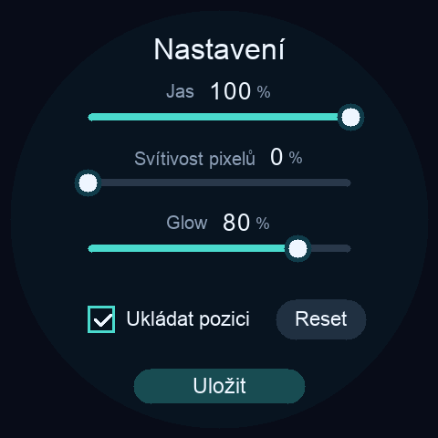

# ARose WaveShare — technická dokumentace

[English](../README.md) | **Česky**

Samostatný firmware pro kulaté displeje **Waveshare ESP32-S3-Touch-LCD-2.1**
a **ESP32-S3-Touch-LCD-2.8C**, oba 480 × 480, ESP32-S3, 8 MB OPI PSRAM
a 16 MB flash. Model se rozpoznává podle CST820 / GT911 před inicializací LCD.

Po startu běží ARose: 96 bodů, duhové barvy, průběžně doznívající
světelná stopa, glow a světlé hlavičky. Verze **0.3.0-xip** obsahuje
dotykové ovládání, plynulou pauzu, jas displeje, svítivost pixelů, glow a volitelné pokračování po restartu.
Firmware neobsahuje Wi-Fi, hodiny ani OTA. Připravený firmware najdete v [Releases](https://github.com/CooLajz/ARose-WaveShare/releases).

Výchozí renderer verze 0.1.0 na 2.8C dosáhl v pětiminutovém testu **46,7 FPS po rozběhu**
při nativním rozlišení, bez vynechaných obnovení ve zbývajících 59 oknech.
První okno mělo 46,27 FPS a dvě delší mezery při startu. Oproti funkční
výchozí verzi s přibližně 32,3 FPS jde o zvýšení asi o 44 %; optimalizace
využívají obě jádra a omezují přenos prázdných oblastí.
Podrobnosti a omezení jsou v [záznamu ověření](../artifacts/VALIDATION.md).

## Ovládání a ukládání

- **Krátce klepněte** pro pozastavení nebo pokračování animace. Zpomalení
  i rozjezd trvají dvě sekundy; další klepnutí během přechodu obrátí směr
  změny rychlosti bez skoku v rychlosti. Také světelná stopa zpomaluje s animací.
- **Podržte prst přibližně 0,7 sekundy** pro otevření jednostránkového nastavení.
- **Jas 5–100 %** ovládá podsvícení displeje a reaguje ihned.
- **Svítivost pixelů 0–100 %** zvýrazňuje jádra bodů a překryvy. Nula zachovává
  dosavadní vzhled; nejde o jas podsvícení.
- **Glow 0–100 %** mění sílu okolní záře. Výchozích 80 % zachovává dosavadní
  vzhled. Velikost záře je pevná, proto se nemění rozsah kreslených oblastí.
- **Ukládat pozici** povoluje checkpoint každé **2 minuty** a obnovení
  při startu. Výchozí hodnota je zapnuto. Po vypnutí a uložení se zapomene
  dosavadní pozice, pravidelné zápisy se zastaví a příští start začne od začátku.
- **Reset** připraví zapomenutí pozice. Opětovným klepnutím lze
  přípravu zrušit. Teprve tlačítko **Uložit** bezpečně zapíše prázdnou pozici
  a poté spustí animaci od začátku, s dvousekundovým rozjezdem.
- **Uložit** zachová jas, svítivost, glow a přepínač i při vypnutém ukládání pozice.
  Nabídka se zavře až po úspěšném zápisu. Při chybě zůstane otevřená pro
  opakování; animace se před úspěšným zápisem neresetuje.

Při otevřeném menu je animace zastavená a pravidelné checkpointy neprobíhají.
Bez resetu se zachová předchozí stav pauzy. Po restartu firmware obnoví
poslední platnou pozici, je-li ukládání zapnuté. Ukládá se matematický stav,
nikoli celý obraz: světelná stopa se znovu postupně vytvoří. Stav pauzy se
neukládá. Při úspěšném pravidelném ukládání se ztratí přibližně nejvýše
poslední 2 minuty postupu. Výchozí jas je 100 %, svítivost 50 % a glow 80 %. Tyto hodnoty platí
pro čistou instalaci; aktualizace zachová existující uložené nastavení.
Dvouminutový interval nahrazuje původní patnáctisekundový zátěžový režim.

Firmware přijímá pouze aktuální formát nastavení, bez migrací starších
prototypových formátů. Záznam má **104 bajtů** včetně verze, tří intenzit, příznaků a CRC. Používá existující 64KiB
NVS oddíl `clockcfg`, vlastní namespace `arose` a klíč `checkpoint`.
[NVS připojuje nové záznamy a recykluje stránky](https://docs.espressif.com/projects/esp-idf/en/v5.1.4/esp32s3/api-reference/storage/nvs_flash.html),
takže se nepřepisuje stále stejné fyzické místo. Původní nastavení hodin v jiných
namespace se nemaže, ani při chybě inicializace. Nezměněný stav při pauze se
znovu nezapisuje; pohyb posuvníku nevyvolává samostatné okamžité zápisy.

Ve starší verzi 0.2.0 na 2.1 trvalo 12 zápisů během tříminutového měření **4,76–6,21 ms**.
Běžná okna měla přibližně **47,5 FPS**, náročná fáze kolem kroku 8 700
měla 38,16 FPS. Nebyly hlášeny timeouty ani zahozené simulační kroky.
Uživatel následně pozoroval posun obrazu při běhu s ukládáním.
Malý záznam sám o sobě nestačí: původní SDK při zápisu flash vypíná cache
potřebnou pro doplňování přenosových bufferů LCD.

Aktuální varianta používá vlastní **ESP-IDF 5.1.4 s PSRAM XIP** pro kód
i konstanty. Cache tak zůstává přístupná i během zápisu. Samostatná úloha
s nízkou prioritou ukládá neměnnou kopii stavu, zatímco animace pokračuje.
Kreslicí smyčka na zápis ani mazání stránky nečeká. Automatické restarty
přenosu LCD jsou vypnuté a po zápisech se nevolá resynchronizace.
Na 2.1 prošlo 43 zrychlených checkpointů včetně tří mazání NVS stránek
při 47,55 FPS bez dlouhých mezer mezi snímky. Také známý náročný úsek
kolem kroku 8 700 po rozběhu držel 47,54–47,55 FPS.
Podrobnosti měření včetně skutečné recyklace NVS jsou v
[záznamu ověření](../artifacts/VALIDATION.md).

Menu využívá dva stávající obrazové buffery. Třetí uchovává původní obraz
animace, který se po zavření obnoví bez ztráty světelné stopy. LVGL ani další
celý framebuffer nejsou potřeba. Ukázka skutečného framebufferu zařízení:



## Vykreslování a paměť

- Simulace zachovává desktopový krok 50 Hz nezávisle na FPS; snímky interpolují pozice.
- Historie, trigonometrická tabulka, barevné tabulky a masky jsou staticky
  alokované v interní SRAM. Palety svítivosti a základních barev (2 560 B) a pracovní pásy se alokují jednou při startu,
  až po přenosových bufferech LCD. V animační smyčce se nealokuje paměť.
- Tři obrazové buffery RGB565 v PSRAM mají dohromady 1 382 400 bajtů.
  Předchozí hotový buffer slouží zároveň jako světelné plátno pro další snímek;
  samostatná kopie celého plátna není potřeba.
- Celý obraz včetně glow vzniká v nativním rozlišení **480 × 480**,
  bez upscalingu. Starší světlo postupně slábne a přidávají se pouze nové
  vzorky simulace. Celá historie bodů se tedy nemusí kreslit každý snímek.
- Plátno i výstup mají formát RGB565. Tabulka 65 536 položek v SRAM
  zeslabuje všechny tři barevné složky jedním čtením. Dva pracovní pásy
  po 480 × 4 pixelech v SRAM zabírají dohromady 7 680 bajtů. Kopírují se jen aktivní oblasti
  a oblasti potřebné k vymazání předchozího obsahu konkrétního bufferu.
- Světlo pod jasnými hlavičkami bodů se ukládá do malého seznamu v SRAM.
  Při čtení předchozího snímku se obnoví, takže se samotné bílé hlavičky
  nepropalují do historie. Všechny překrývající se hlavičky se zálohují
  před jejich vykreslením. Odpadají tak zápisy samostatného světelného plátna
  do PSRAM při zachování stejného obrazu.
- Svítivost přepočítává dvě palety po 256 barvách pouze při změně nastavení.
  Vnitřní smyčka nadále jen načítá hotovou barvu; nepřibývají body ani průchody
  plátnem. Zesílené barvy mají širší pracovní rozsah a oříznou se až po
  aplikaci pokrytí pixelu při přičtení do RGB565. Protože plátno již sčítá světlo, nejde o přesnou kopii desktopového
  přechodu mezi alpha a aditivním skládáním. Zvýšení svítivosti zesílí barvy
  stopy a zesvětlí čelní jádra, halo zůstává stejné. Samostatný posuvník glow
  přepočítává původní tabulku barev halo, rovněž bez dalších průchodů obrazem.
- RGB565 omezuje jemnost barev a slabých konců stopy; tento renderer není
  obrazově totožný s desktopovým Metal rendererem. Zachovává matematickou
  sekvenci, ale mění způsob skládání světla.
- Nejčastěji používané vykreslovací funkce běží z interní IRAM.
- Jádro 0 obsluhuje LCD a kreslí třetinu pásů. Jádro 1 kreslí zbývající
  dvě třetiny. Synchronizace před prezentací zaručuje dokončení obou částí.
  Dva přenosové buffery LCD po 40 řádcích v SRAM spotřebují celkem 76 800 bajtů.
- Před opětovným použitím obrazového bufferu se čeká na dokončení přenosu.
  Požadovaný pixelový takt je 13 MHz; frekvence prezentace na 2.8C
  je přibližně 46,7 Hz. Není zaměnitelná s frekvencí simulace 50 Hz.
- Koeficient doznívání světla zohledňuje periodu konkrétního panelu,
  aby zvýšení FPS zbytečně nezkracovalo stopu. Na konci smyčky není další
  pevné zpoždění; úlohu blokuje dokončení rendereru a prezentace LCD.

## Zvažované alternativy

Průzkum zdrojů proběhl 30. 10. 2026. Obě desky mají RGB panel ST7701,
480 × 480; oficiální [ESP32_Display_Panel je uvádí mezi podporovanými deskami](https://github.com/esp-arduino-libs/ESP32_Display_Panel/blob/master/docs/board/board_waveshare.md).

| Varianta | Zjištění a rozhodnutí pro prototyp |
| --- | --- |
| Arduino_GFX | [RGB backend používá `esp_lcd`](https://github.com/moononournation/Arduino_GFX/blob/master/src/databus/Arduino_ESP32RGBPanel.cpp). Přechod by sám neodstranil opakované kreslení historie ani přenosy PSRAM. |
| ESP32_Display_Panel | Užitečná podpora hotových desek; prototyp již obsahuje potřebné inicializace obou panelů. Migrace nebyla provedena ani měřena. |
| LovyanGFX | [Vlastní RGB/DMA backend](https://github.com/lovyan03/LovyanGFX/blob/master/src/lgfx/v1/platforms/esp32s3/Bus_RGB.inl) obnovuje DMA při VSYNC. Je to skutečně odlišný ovladač, ale jeho přínos pro tento renderer zatím není změřený. |
| Přímý DMA přenos z PSRAM | Vyzkoušený; při 18 MHz uživatel pozoroval posun obrazu. Nahrazen přenosem přes SRAM a nižším taktem. |
| Nízké rozlišení glow + upscale | Vyzkoušené; zejména 120 × 120 vytvářelo rušivé artefakty u překryvů. Aktuální renderer nepoužívá upscale. |
| Perzistentní světlo v předchozím RGB565 framebufferu | Aktuální řešení. Místo celé historie přidává nové body a zeslabuje dosavadní obraz. Odpadá převod barevného formátu i zápis dalšího celého plátna. |
| Vlastní sestavení ESP-IDF | Od verze 0.2.1 implementováno: XIP pro kód i konstanty, 64B řádky datové cache a ukládání v samostatné úloze. Arduino jádro a renderer zůstávají stejné. |

[Espressif popisuje příčiny posunu RGB obrazu](https://docs.espressif.com/projects/esp-faq/en/latest/software-framework/peripherals/lcd.html#why-do-i-get-drift-overall-drift-of-the-display-when-esp32-s3-is-driving-an-rgb-lcd-screen):
vysoký pixelový takt, nedostatečná propustnost paměti nebo zpoždění obsluhy
přenosu. Doporučuje mimo jiné snížení taktu a přenos přes SRAM (bounce buffers).
[Dokumentace RGB ovladače](https://docs.espressif.com/projects/esp-idf/en/v5.1.4/esp32s3/api-reference/peripherals/lcd.html#rgb-interfaced-lcd)
popisuje varianty přenosu i jejich paměťové nároky.
Původní předkompilované SDK má 32bajtové řádky datové cache; vlastní XIP
sestavení používá doporučených 64 bajtů. Takt panelu zůstává 13 MHz.
Fyzickou stabilitu přenosu je nadále nutné ověřovat na panelu.

## Lokální sestavení

Doporučená varianta s ukládáním používá **ESP-IDF 5.1.4** (revize
`d7b0a45ddbddbac53afb4fc28168f9f9259dbb79`) a nezměněné zdroje jádra
**Arduino-ESP32 3.0.7** s knihovnou `Wire`. LVGL není potřeba.
CMake adaptér v `idf/` sestavuje jen potřebné Arduino části; knihovny
pro síťové služby se nezapínají.

```sh
# Jednorázově připravte oddělené SDK a jeho nástroje:
./tools/setup-xip.sh
./build-xip.sh
./upload-xip.sh /dev/cu.usbmodem…
```

Skripty používají na tomto Macu `/tmp/arose-waveshare-xip`, protože
IDF potřebuje pracovní cestu bez mezer. Místo lze pro všechny tři kroky
přepsat proměnnou `AROSE_XIP_HOME`; po vyčištění dočasného adresáře je nutné
přípravu SDK zopakovat. `AROSE_XIP_BASE_PYTHON` vybírá základní Python
(ověřeno s 3.9). Cestu k jádru 3.0.7 zjistí sestavovací skript z lokální
konfigurace Arduino CLI; lze ji přepsat přes `AROSE_ARDUINO_CORE`.
Žádné soubory instalovaného Arduino jádra se neupravují.

Konfigurace je v `idf/sdkconfig.defaults`. Při její změně se generované
nastavení obnoví z těchto výchozích hodnot. Kód rendereru se stále sestavuje
s `-O3`; systémové knihovny s `-Os`. Méně kritické funkce FreeRTOS, správy
paměti a kruhových bufferů využívají XIP, aby zbyl dostatečný souvislý blok
SRAM pro dva LCD buffery po 40 řádcích. Výsledky včetně ELF, mapy a skutečné
konfigurace se ukládají do `build/xip/`. Při chybějícím XIP nebo zapnuté
pravidelné resynchronizaci se kompilace této varianty zastaví.

Původní předkompilovaná varianta zůstává dostupná pro srovnání přes
`./build.sh` a `./upload.sh`. **Neobsahuje XIP ani ukládání na pozadí**
a posun obrazu při zápisu u ní byl pozorován. Používá Arduino CLI 1.3.1;
lokální runtime a konfigurace jsou ignorované v `.arduino/`.

Před nahráním zvolte skutečný port konkrétního zařízení. Upload přepíše
bootloader, partition table, OTA výběr a aplikaci v prvním slotu. Neprovádí
plošné mazání flash; zachovává rozložení partition z projektu hodin.
Žádné původní aplikace v druhém slotu tento prototyp nespouští.
Nahrávání samo nevytváří zálohu.

FQBN obsahuje CPU 240 MHz, QIO 80 MHz, 16MB flash, OPI PSRAM a USB HWCDC.
`tools/toolchain.sh` umožňuje přepsat cesty přes `ARDUINO_CLI_BIN`,
`ARDUINO_CONFIG_FILE`, `ESPTOOL_DIR`, `CTAGS_DIR` a `PYTHON_BIN`.
Na jiném počítači připravte odpovídající instalaci Arduino-ESP32 3.0.7
a lokální konfiguraci Arduino CLI. Cesty lze nastavit lokálně pomocí uvedených proměnných.

Výsledky původní varianty jsou v `build/`, XIP varianty v `build/xip/`.
Používejte odpovídající skript `upload.sh` nebo `upload-xip.sh`, nikoli zápis
celého 16MB merged obrazu; ten obsahuje také prázdné oblasti flash.

## Diagnostika

UART přes CH343P i nativní USB CDC mají diagnostiku na 921600 baud.
Každých pět sekund firmware vypíše FPS, časy rendereru, počet chyb,
volnou paměť, rozpoznaný model a jas. Příkaz `?` vypíše aktuální stav,
příkaz `c` odešle neměnný snímek RGB565. Diagnostické příkazy `p` a `m`
přepínají pauzu a menu (`m` v menu vyžádá uložení); `+` a `-` mění jas
 o pět procentních bodů, `[` a `]` svítivost a `{` a `}` glow o deset. V otevřeném menu `e`
 přepíná ukládání pozice a `r` připraví nebo zruší reset. `s` respektuje
 vypnuté ukládání i otevřené menu.
Řádek `UI` uvádí stav ovládání, `CHECKPOINT` výsledek a dobu uložení
a `RESTORE` výsledek obnovení při startu. XIP verze přidává řádek `SDK`
a příkaz `s` pro jednorázové vyžádání checkpointu. `erases` a `erase_ms`
výslovně měří volání mazání flash při daném zápisu; `elapsed_ms` zahrnuje
i čekání úlohy na procesor. Nejde o dobu zastavení animace. Zachycení snímku na několik sekund
pozastaví animaci; následně pokračuje bez skoku v simulaci.

Řádek `PACING` obsahuje nejdelší mezeru mezi předáními snímků a počet
`late` v daném okně: mezer přesahujících 1,5 periody panelu. `PROFILE`
uvádí časy obou pracovníků; součty dílčích fází nejsou celkovým časem
rendereru, protože se jejich práce překrývá. Ten uvádí `render_ms` a `max_ms`.

```sh
source tools/toolchain.sh
"$PYTHON_BIN" tools/device.py /dev/cu.usbmodem… --seconds 30
"$PYTHON_BIN" tools/device.py /dev/cu.usbmodem… --capture artifacts/frame.png
"$PYTHON_BIN" tools/device.py /dev/cu.usbmodem… --capture artifacts/frame.png --capture-delay 35
```

Některé USB převodníky při otevření portu desku restartují i při požadavku
na neaktivní DTR/RTS. Volitelná prodleva umožňuje zachytit pozdější fázi animace.

## Ověření

```sh
tools/test.sh
```

Nativní test s AddressSanitizer a UndefinedBehaviorSanitizer porovnává
54 bodů na devíti místech původní sekvence až do kroku 30 000.
Kontroluje konečné souřadnice, toleranci proti desktopovému enginu,
obrazové hranice, shodu tří rotujících výstupních bufferů se samostatným
rendererem používajícím jeden výstup a opakované zobrazení stejného snímku
bez dalšího přidávání světla. Testovací obraz vznikne v
`.arduino/tests/preview.ppm`. Pásy se i v hostitelském testu vykreslují
ve dvou skutečných vláknech. Další testy ověřují návaznost generátoru
po obnovení, odmítnutí neplatných záznamů, rozlišení dotykových gest,
rozsahy tří posuvníků, odmítnutí nepodporovaných formátů, potvrzení nebo chybu uložení,
přesný integrál dvousekundových přechodů, reset plátna a návrat z menu bez
zbytků UI v animaci. Stejné obrazce se porovnávají při různých intenzitách,
včetně návratu na přesně shodný výchozí obraz.

Pro reprodukci krátkého zátěžového testu lze při sestavení přepsat takt
a počáteční simulační krok. Nejde o nastavení ukládané do zařízení:

```sh
./build.sh --build-property 'compiler.cpp.extra_flags=-MMD -c -DAROSE_PIXEL_CLOCK_HZ=13000000 -DAROSE_START_FRAME=6800'
```

Pro XIP lze stejný úsek zvolit přes `AROSE_START_FRAME=6800 ./build-xip.sh`.
Před běžným použitím sestavte znovu bez tohoto parametru: `./build-xip.sh`
(pro původní variantu `./build.sh`). Standardní firmware
obnovuje uloženou pozici, nebo bez platného záznamu začíná od nuly.
Nenulový `AROSE_START_FRAME` přeskočí načtení uložené pozice, ale pravidelné
ukládání zůstává aktivní. Přepínače `-MMD -c` jsou součástí výchozí konfigurace
Arduino-ESP32 3.0.7 a při jejím přepsání je nutné je zachovat.

Renderer byl fyzicky ověřen na **2.8C i 2.1** a uživatel potvrdil kvalitu
obrazu. Nové ovládání a ukládání verze 0.2.0 byly nahrány na **2.1**:
UART test ověřil pauzu, menu, jas i skutečný restart s obnovením z flash.
Následný posun při zápisu vedl k vlastnímu XIP sestavení. Varianta XIP
prošla na 2.1 zátěžovým testem zápisů, recyklace NVS a obnovy; na 2.8C
zatím fyzicky otestována nebyla.
Uživatel při sledování XIP verze a zátěžového testu zápisů na 2.1 potvrdil,
že obraz drží na místě a pohyb je plynulý. Gesta byla ověřena automatickými
testy; toto potvrzení obrazu samo neověřuje fyzické ovládání prstem.
Naměřené výsledky a snímky jsou v `artifacts/`; aktuální závěr je uveden
v [záznamu ověření](../artifacts/VALIDATION.md). Počítadlo chyb sleduje timeouty
synchronizace; samo nedetekuje vizuální posun, tearing ani subjektivní kvalitu glow.

Původ zdrojů a licenční informace jsou v `THIRD_PARTY_NOTICES.md`.

Zátěžový test XIP firmwaru lze spustit výslovně tímto příkazem:

```sh
source tools/toolchain.sh
"$PYTHON_BIN" tools/test-device-xip.py /dev/cu.usbmodem… --log artifacts/profile-xip-stress-21.txt
```

Test po úvodním běhu vyžádá nejvýše 400 checkpointů v kratších intervalech,
až ověří alespoň tři skutečná mazání flash. Poté vrátí běžný interval, ověří
pauzu, nabídku, vynechání shodného zápisu a restart s obnovením. Po dobu
testu neovládejte dotykovou obrazovku. Neprovádí plošné mazání ani zálohu.


Test nastavení verze 0.3.0 (mění nastavení a restartuje zařízení):

```sh
source tools/toolchain.sh
"$PYTHON_BIN" tools/test-device-settings.py /dev/cu.usbmodem… --log artifacts/profile-settings-glow-21.txt --screenshot artifacts/settings-controls-device-21.png
```

Ověřuje brzdění a rozjezd, přepínač zápisů, zachování všech tří hodnot po
restartu, odložený reset a FPS při maximální svítivosti i glow. Na konci
nastaví jas 100 %, svítivost 0 %, glow 80 % a zapnuté ukládání pozice.
Po dobu automatického scénáře neovládejte dotykovou obrazovku.


Závěrečné měření skutečného dvouminutového intervalu a maximálních efektů:

```sh
"$PYTHON_BIN" tools/test-device-final.py /dev/cu.usbmodem… --log artifacts/profile-settings-final-21.txt --screenshot artifacts/settings-controls-device-21.png
```
