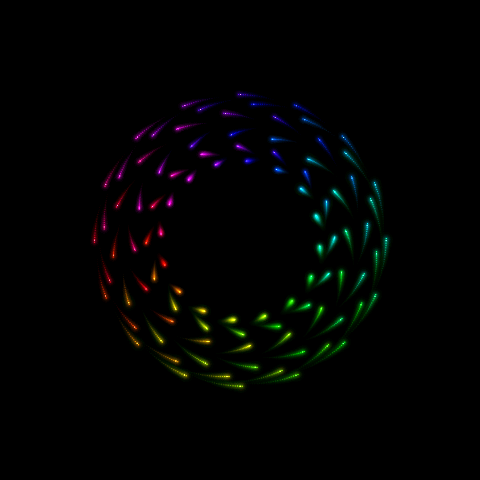
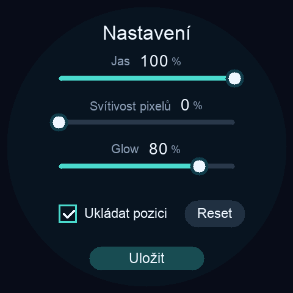

# ARose WaveShare — technical reference

**Amiga-era generative art, modern glow, and smooth motion on a round ESP32-S3 display.**

**English** | [Česky](../README.cs.md)

ARose WaveShare brings the evolving patterns of [ARose ScreenSaver](https://github.com/CooLajz/ARose-ScreenSaver) to the **Waveshare ESP32-S3-Touch-LCD-2.1** and **ESP32-S3-Touch-LCD-2.8C**. It renders 96 moving rainbow points, soft halos, and fading trails at native **480 × 480**, without upscaling, Wi-Fi, or a desktop GPU.

The renderer reaches about **47.55 FPS on the 2.1-inch display**. This is a standalone demo, using display and touch drivers adapted from [WaveShare Hodiny](https://github.com/CooLajz/waveshare-hodiny).

<p align="center">
  
  
</p>

*Actual device framebuffer captures. The animation capture illustrates the native renderer; the settings capture shows the current interface. These are not photographs of the physical panel.*

## Install the demo

Download the **factory `.bin`** from the [latest release](https://github.com/CooLajz/ARose-WaveShare/releases/latest) and follow the [web flashing guide](../docs/FLASHING.md). One firmware detects both supported boards automatically.

No build environment is required. The firmware replaces the running application. It is intended for the two **ESP32-S3** boards listed below, not similarly named ESP32-P4 or other Waveshare models.

| Board | Resolution / memory | Verification |
| --- | --- | --- |
| ESP32-S3-Touch-LCD-2.1 | 480 × 480; 16 MB flash; 8 MB OPI PSRAM | Current XIP firmware, settings, resume, reset and flash writes tested on hardware |
| ESP32-S3-Touch-LCD-2.8C | 480 × 480; 16 MB flash; 8 MB OPI PSRAM | Native renderer tested at about 46.7 FPS; current XIP/settings build still needs hardware validation on this model |

The touch controller is detected before the panel initialization sequence is selected: CST820 for 2.1, GT911 for 2.8C.

## Touch controls

- **Tap** to pause or resume. Motion smoothly slows down or speeds up over **two seconds**.
- **Hold for about 0.7 seconds** to open settings. The animation freezes while the menu is open.
- **Jas** — display backlight, 5–100%; default 100%.
- **Svítivost pixelů** — point luminosity, 0–100%; default 50%. Higher values strengthen point cores and overlapping light. Zero keeps the original ESP renderer appearance; the scale is not an exact colorimetric match to the desktop renderer.
- **Glow** — halo intensity, 0–100%; default 80%. Halo size remains fixed to keep rendering cost predictable.
- **Ukládat pozici** — remember animation position every **two minutes**; enabled by default.
- **Reset** — stage a restart from the beginning. Tap again to cancel the pending reset.
- **Uložit** — save settings and close. A pending reset clears the saved position and starts the animation only after the write succeeds.

Fresh installations start with backlight 100%, luminosity 50% and glow 80%. Existing saved settings are retained on updates.

The current on-device interface is in Czech; the labels above explain every control. Backlight, luminosity and glow are saved even when position saving is disabled. Disabling position saving also clears the old position, so the next boot starts from the beginning. Pause state is not saved.

Checkpoints store the generator state, not a screenshot. Trails build up again after a restart; up to approximately two minutes of progress can be lost. The unchanged state of a fully paused animation is not written repeatedly.

## What makes it smooth

- A **50 Hz simulation**, independent of display FPS, with interpolated positions.
- Full-resolution persistent RGB565 light: fade the previous frame and draw only new samples instead of rebuilding the entire trail history.
- Three framebuffers in PSRAM; hot lookup tables and two small rendering bands in internal SRAM.
- Rendering shared across both CPU cores, with empty-area tracking to reduce memory traffic.
- Two internal SRAM LCD bounce buffers, 40 rows each, at a conservative **13 MHz pixel clock**.
- A custom **ESP-IDF 5.1.4 + Arduino-ESP32 3.0.7** build with PSRAM XIP for instructions and constants, keeping the LCD feed available during flash operations.
- Low-priority asynchronous checkpoint writes. No periodic LCD restart or post-write resynchronization.
- Lighting palettes recomputed only when settings change. Amplified point colors retain their range until coverage and final RGB565 compositing, avoiding premature clipping.

RGB565 and the persistent light canvas differ from desktop Metal rendering. The mathematical sequence is retained; the light compositing is adapted to this hardware.

### Measured results

On the 2.1 board, the final two-minute test ran with **luminosity 100% and glow 100%**:

| Metric | Result |
| --- | --- |
| FPS in 23 complete measured windows | **47.55** in every window |
| LCD timeouts / dropped simulation steps | **0 / 0** |
| Long frame gaps during the measured animation | **0** |
| Checkpoint including real NVS page erase | **26.88 ms**, handled in the background |
| NVS erase portion | **19.31 ms** |

The operation time is the background task's elapsed time, not an animation freeze. Menu transitions and initial rendering are excluded from steady-state figures and can take longer. These measurements cover specific sequences, not every possible future pattern.

See the [final raw log](../artifacts/profile-settings-final-21.txt), [settings/reboot test](../artifacts/profile-settings-glow-21.txt), and [detailed validation history in Czech](../artifacts/VALIDATION.md). Users also confirmed smooth, stable output on the physical 2.1 panel.

## Build from source

The tested host is **macOS**. The scripts also provide paths for a standard Arduino CLI installation; Linux/WSL builds have not been validated on hardware.

Required: Git, Bash, a C++ compiler for host tests, Python with `venv`, and [Arduino CLI](https://arduino.github.io/arduino-cli/). Python 3.9 was used for the pinned IDF toolchain.

```sh
arduino-cli core update-index --additional-urls https://espressif.github.io/arduino-esp32/package_esp32_index.json
arduino-cli core install esp32:esp32@3.0.7 --additional-urls https://espressif.github.io/arduino-esp32/package_esp32_index.json

./tools/setup-xip.sh
./build-xip.sh
./upload-xip.sh /dev/cu.usbmodem...
```

Use your actual USB serial port. The setup downloads the pinned Espressif SDK/tools into `/tmp/arose-waveshare-xip`, separate from the source tree. Set **`AROSE_XIP_HOME`** to a persistent path without spaces before all three commands if you prefer to keep the toolchain across temporary-directory cleanup. `AROSE_XIP_BASE_PYTHON` selects the setup Python.

`build-xip.sh` locates core 3.0.7 through Arduino CLI. For an existing installation, set **`AROSE_ARDUINO_CORE`** directly to its `esp32/3.0.7` directory. `ARDUINO_CLI_BIN` and `ARDUINO_CONFIG_FILE` can select a non-default CLI installation. The Arduino core and ESP-IDF sources are not patched.

Outputs are written to `build/xip/`. The upload script checks XIP configuration and flashes only the bootloader, partition table, OTA selection and application. It does not erase the entire flash chip.

The older `build.sh` / `upload.sh` workflow is retained for development comparison. It depends on the local Arduino tool overrides described in [the Czech technical notes](../README.cs.md) and **does not provide XIP or asynchronous storage**. Use the XIP build for normal operation with checkpoint saving.

## Tests and diagnostics

```sh
./tools/test.sh
```

Host tests use AddressSanitizer/UndefinedBehaviorSanitizer and two real rendering threads. They cover desktop sequence reference points, rotating framebuffers, lighting levels, checkpoint format/CRC, touch gestures, transactional save/reset, and the exact integral of the two-second motion ramp.

UART diagnostics run at **921600 baud**. `?` prints status, `p` toggles pause, `m` opens settings or saves/closes them, `+`/`-` change backlight, `]`/`[` change luminosity, and `}`/`{` change glow. In the menu, `e` toggles position saving and `r` toggles pending reset. `c` captures a framebuffer and temporarily pauses rendering. Opening some USB bridges can reset the board.

Hardware test scripts in `tools/` explicitly change settings and reboot the device. Their logs distinguish intentional pauses from steady animation. Further details and reproduction commands are in [README.cs.md](../README.cs.md).

## Storage

A checkpoint is **104 bytes**, including settings, version and CRC. ESP-IDF NVS appends records and recycles pages in the 64 KiB `clockcfg` partition, namespace `arose`; it does not overwrite a single physical address on every save. Other namespaces are retained. No erase-on-error fallback is used.

Only the current checkpoint format is accepted; there is no migration code. Settings are committed before the menu closes or a pending reset is applied. A failed save leaves the menu open for retry. The two-minute interval reduces scheduled writes eightfold compared with the earlier 15-second stress-test setting.

## Credits and license

Original **ARose**: **Wolfgang Breyha and Michael Matzl, 1994–1995**. This project builds on [ARose ScreenSaver](https://github.com/CooLajz/ARose-ScreenSaver) and the panel drivers from [WaveShare Hodiny](https://github.com/CooLajz/waveshare-hodiny), derived from Waveshare examples.

Please see [LICENSE](../LICENSE) and [THIRD_PARTY_NOTICES.md](../THIRD_PARTY_NOTICES.md) for scope and attribution. No private original source archives are included. This is an independent community demo, not an official Waveshare firmware.
